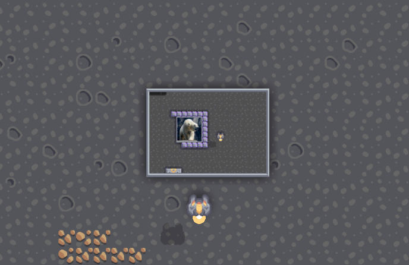

# Mindustry Image Renderer

This script generates a Mindustry Schematics where a bunch of processor draw a image to tiled displays.


## Linux
Download `mindcore.jar` in https://github.com/cardillan/mindcode/releases and place it in the directory where `compile.sh` is.
Then execute:
```
./compile <image-path> <width> <height> <output-schematic-name>
```
`<widht>` and `<height>` refers to the number of columns and row of tiled display.

`<output-schematic-name>` is the name of the `.msch` schematic file, don't write the file extension the code do it.


## Third-Party Software

This project uses Mindcode, a high-level programming language compiler for Mindustry Logic.

* Project: cardillan/mindcode
* License: MIT License
* Usage: Mindcode is used as an external dependency through its mindcode.jar executable.

Mindcode is developed and maintained by its respective authors and is not part of this project.



